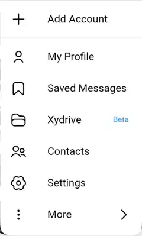
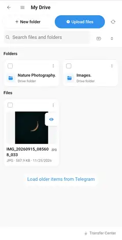
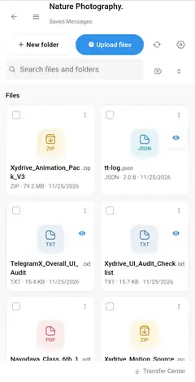
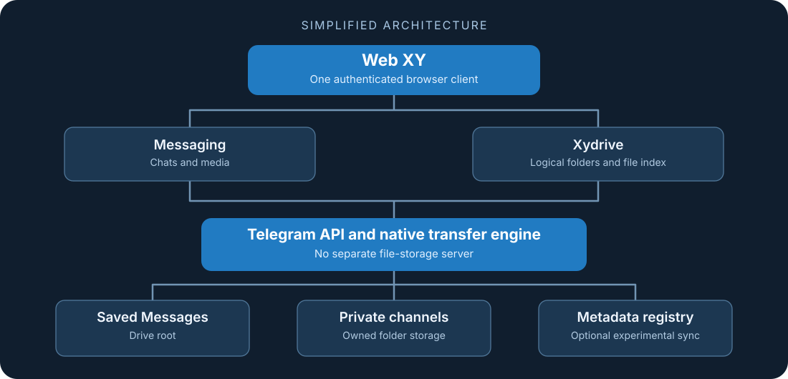

# Web XY

**Beyond conversations.**

---

## Beyond messaging

Web XY brings messaging and personal cloud file management together in one responsive web experience. It explores a productivity-focused approach while retaining the existing Telegram messaging and media foundations.

## Introducing Xydrive

**Your files. Your folders. Your cloud.**

Xydrive is a dedicated, full-page file-management workspace within the authenticated client. Enable **Xydrive Beta** in **Settings → Experimental**, then open **Xydrive** from the main menu.

### A look inside Web XY

<table>
  <tr>
    <th width="33%">Open Xydrive</th>
    <th width="33%">My Drive</th>
    <th width="33%">Inside a folder</th>
  </tr>
  <tr>
    <td valign="top"></td>
    <td valign="top"></td>
    <td valign="top"></td>
  </tr>
</table>

Actual mobile screenshots from the running prototype, cropped for presentation.

| Capability | What Xydrive offers |
| :--- | :--- |
| Cloud workspace | Grid and list views, folder navigation and contextual file actions. |
| Folder hierarchy | Saved Messages as the root; eligible owned private channels as folder storage. |
| Native transfers | Multiple-file selection, desktop drag-and-drop, download and transfer progress. Cancellation depends on the native transfer stage. |
| Media experience | Native previews for supported photos, video and audio; other documents open through Telegram. |
| Smart organization | Search loaded files, sort, filter, favorite, pin and assign display aliases. |
| Storage insights | Bounded indexing, known file sizes, file-type distribution and folder totals. |
| Cloud synchronization | Opt-in experimental synchronization of folder and organization metadata across devices. |
| Adaptive interface | Responsive workspace layouts and existing theme integration. |

<!-- Additional actual desktop, dark-theme and transfer screenshots may be added later. -->

## Native by design

Xydrive reuses the authenticated Telegram session, native media viewer and transfer engine. Files remain in Telegram; there is no additional file-storage server or file proxy. Folder hierarchy and display aliases are logical metadata rather than changes to original Telegram filenames.

- **Account-owned storage:** Saved Messages and eligible private channels.
- **Native integration:** Telegram-managed upload limits, media access and transfer restrictions.
- **Metadata sync:** A private broadcast channel stores organization metadata when explicitly enabled.

## Product philosophy

**Simplicity.** Powerful organization without unnecessary complexity.

**Performance.** Reuse established native client capabilities.

**Integration.** Extend the experience rather than replace Telegram infrastructure.

**Transparency.** Make the storage model, limitations and project status clear.

## The vision

A distinct, productivity-focused web client that complements the Telegram ecosystem.

**Proposed address:** `web.telegram.org/xy/`

